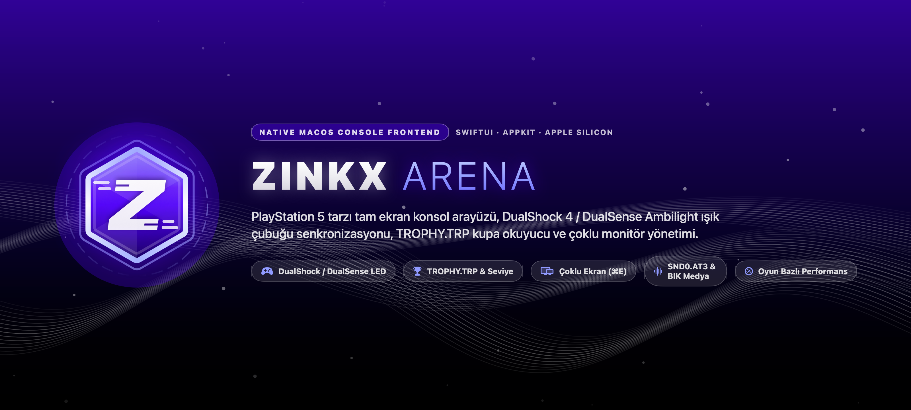
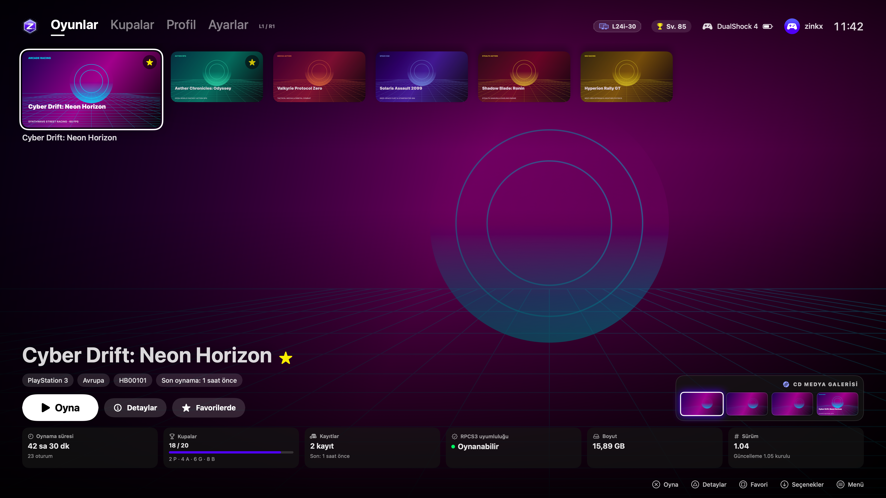
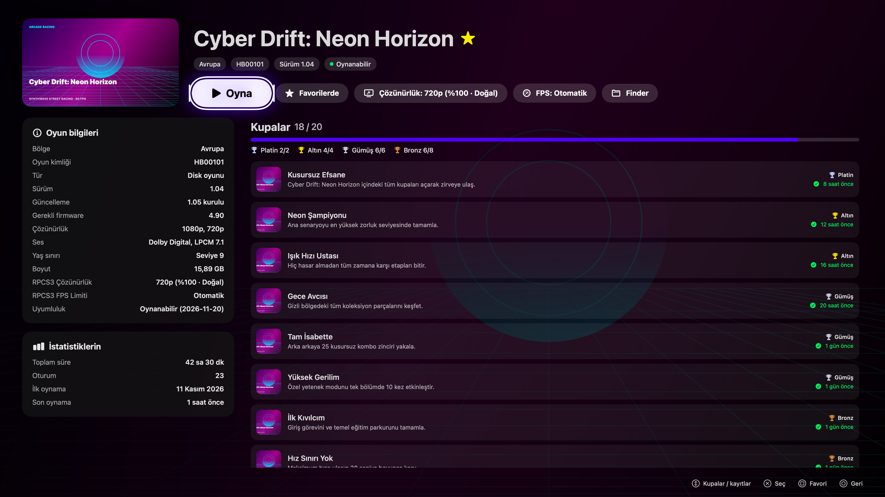
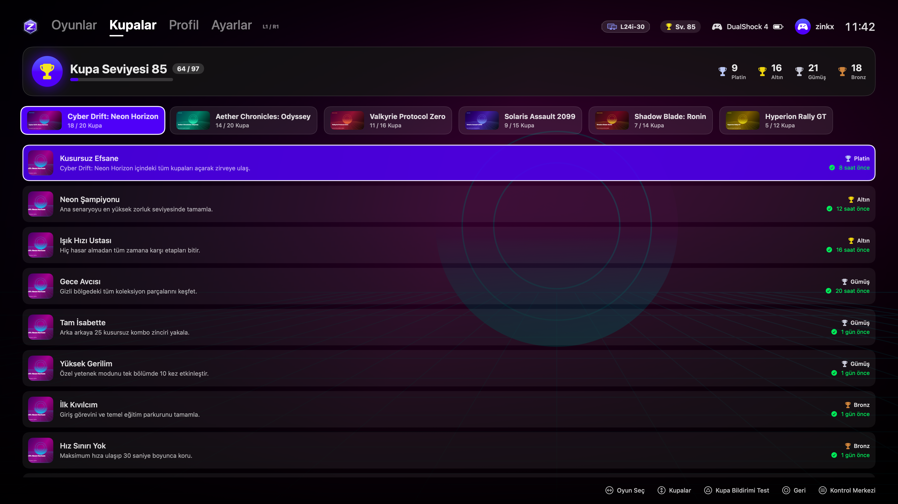
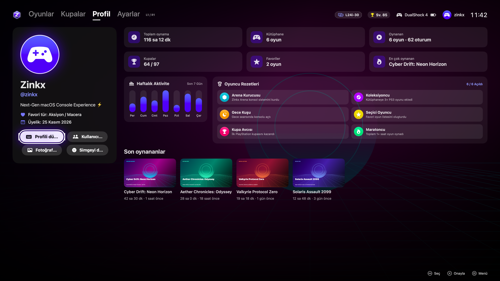
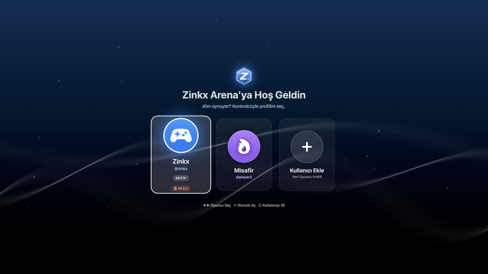
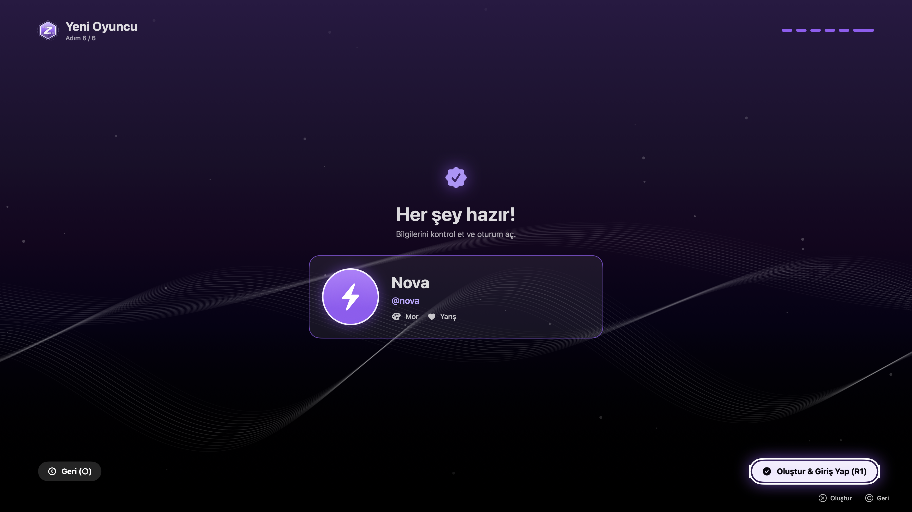
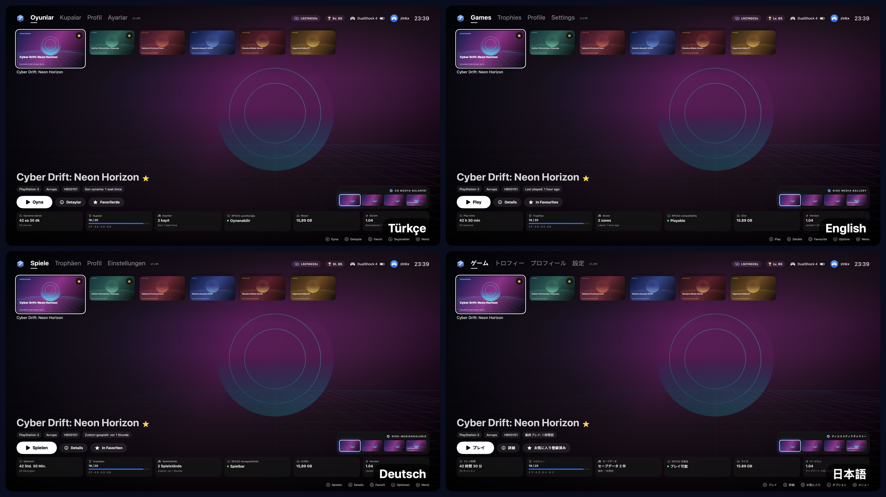

<div align="center">



# ⚡ ZINKX ARENA

**macOS (Apple Silicon & Intel) için PlayStation 5 Tarzı Tam Ekran Konsol Arayüzü, Kupa Motoru ve Kütüphane Yöneticisi**  
*Next-Generation Native SwiftUI & AppKit Console Frontend, Trophy Parser, and Smart Controller Suite for macOS*

[-0070F2?style=for-the-badge&logo=apple&logoColor=white)](https://github.com/zinkxx/zinkx-arena)
[](https://swift.org)
[](https://developer.apple.com/xcode/swiftui/)
[](LICENSE)
[](LEGAL_DISCLAIMER.md)
[](#-v21de-neler-yeni--whats-new-in-21)
[](https://github.com/zinkxx/zinkx-arena/releases/latest)
[](https://github.com/zinkxx/zinkx-arena/actions/workflows/build.yml)

[**⬇️ İndir / Download**](https://github.com/zinkxx/zinkx-arena/releases/latest) · [**🆕 v2.1'de Yeni**](#-v21de-neler-yeni--whats-new-in-21) · [**🇹🇷 Türkçe Dokümantasyon**](#-türkçe-dokümantasyon) · [**📸 Ekran Görüntüleri**](#-ekran-görüntüleri--screenshots) · [**✨ Özellikler**](#-öne-çıkan-özellikler) · [**🚀 Kurulum**](#-kurulum-ve-derleme) · [**🇬🇧 English Documentation**](#-english-documentation) · [**⚖️ Yasal Uyarı**](LEGAL_DISCLAIMER.md)

</div>

## 🎬 Demo

https://github.com/user-attachments/assets/23d4c077-5aa3-41d9-a690-d7ef1bdaa6a5

## 🆕 v2.1'de Neler Yeni? / What's New in 2.1

<table>
<tr>
<td width="50%" valign="top">

### 🌐 8 Dilde Arayüz
**Türkçe · English · Deutsch · Français · Español · 日本語 · 简体中文 · 한국어**

Uygulama varsayılan olarak macOS dilini kullanır. **Ayarlar → Görünüm → Dil** bölümünden yeniden başlatmadan anında değiştirilebilir. Tarihler, sayılar, dosya boyutları ve ekran klavyesi düzeni (QWERTZ, AZERTY…) de seçilen dile uyum sağlar.

<sub>*8 UI languages. Follows macOS by default and switches live, with locale-aware dates, numbers and keyboard layouts.*</sub>

</td>
<td width="50%" valign="top">

### 👤 Yeni Oyuncu Kayıt Sihirbazı
Yeni bir oyuncu, tam ekran ve adım adım ilerleyen bir kayıt akışıyla eklenir:

**Ad → Kullanıcı adı → Avatar → Renk → Favori tür → Özet**

Gezinme kontrolcüyle yapılır: `R1` ileri, `○` geri. Seçilen renk, profilin tema rengi olur.

<sub>*A full-screen, step-by-step sign-up flow for new players.*</sub>

</td>
</tr>
<tr>
<td width="50%" valign="top">

### 🚀 Oyun Sırasında Sıfır Arka Plan Yükü
Oyun açıkken konsol arayüzü kendini tamamen uykuya alır. Daha önce M1 üzerinde yaklaşık **%40 çekirdek** harcıyordu. Disk medya dönüştürmeleri de oyun boyunca duraklatılır. Böylece işlemci gücünün tamamı RPCS3'e kalır.

<sub>*The hidden UI no longer competes with RPCS3 for CPU while you play.*</sub>

</td>
<td width="50%" valign="top">

### 🖼️ Retina'da Keskin Görüntü
RPCS3 çıktısı artık **FidelityFX Super Resolution (FSR)** ile ölçekleniyor ve **16x anizotropik filtreleme** açık. Oyunun detay ekranından 1080p profilini seçerek en net görüntüyü alabilirsin.

<sub>*FSR upscaling and 16x AF. On an M1 MacBook Air, a racing title ran at 55–60 fps with the 1080p profile.*</sub>

</td>
</tr>
<tr>
<td colspan="2" valign="top">

### ✨ Daha Temiz Açılış
Açılış animasyonu her seferinde sonuna kadar oynar. Ardından gelen **"Kim oynuyor?"** ekranında bir profil seçmek zorunludur. Ana ekran bu ekranın arkasından görünmez ve seçimden sonra ekran tekrar açılmaz. · <sub>*The boot intro plays through and the user picker is mandatory and opaque.*</sub>

</td>
</tr>
</table>

> 📋 Tüm değişiklikler / Full list: [CHANGELOG.md](CHANGELOG.md) · [v2.1.0 sürümü / release](https://github.com/zinkxx/zinkx-arena/releases/tag/v2.1.0)

---

> [!IMPORTANT]
> **⚖️ Yasal Uyarı ve Korsan Karşıtı Politika (Legal & Anti-Piracy Notice)**  
> **Zinkx Arena**, yalnızca yerel medya kütüphanenizi yönetmek için geliştirilmiş **bağımsız ve açık kaynaklı bir grafiksel kullanıcı arayüzüdür (Frontend / Launcher)**.  
> - Bu depoda **hiçbir ticari oyun dosyası (`ISO`, `ROM`, `PKG`, `EBOOT.BIN`), Sony sistem yazılımı (`PS3UPDAT.PUP`), BIOS dökümü, şifreleme anahtarı veya telifli görsel/ses materyali bulunmamaktadır**.  
> - Uygulama içerisinde hiçbir oyun indirme bağlantısı veya korsan içerik sağlayıcısı yer almaz.  
> - Bu sayfada ve `--demo` modunda yer alan tüm oyun isimleri (*Cyber Drift: Neon Horizon*, *Aether Chronicles: Odyssey*, *Valkyrie Protocol Zero* vb.) ile kapak görselleri, CoreGraphics ile prosedürel olarak çizilmiş **%100 özgün ve kurgusal (homebrew) vitrin içerikleridir**.  
> - Kullanıcılar bu arayüzü yalnızca **yasal olarak satın aldıkları fiziksel disklerinden kendi oluşturdukları kişisel yedekleriyle** veya yasal homebrew yazılımlarla kullanmakla yükümlüdür. Detaylar için [LEGAL_DISCLAIMER.md](LEGAL_DISCLAIMER.md) dosyasına göz atabilirsiniz.

---

## 📸 Ekran Görüntüleri / Screenshots

### 1. Ana Konsol Medya Merkezi (Home Media Hub)
Oyun kartları, dinamik arka plan görselleri, disk medya galerisi, canlı kontrolcü pil durumu, aktif ekran seçici (`⌘E`) ve alt bilgi rafı (`InfoShelf`).



---

### 2. Oyun Detayları, `PARAM.SFO` Analizi ve Oyun Bazlı Performans Profili
Her oyun için ikili `PARAM.SFO` başlık okuyucu, çözünürlük/FPS/Shader profili seçici, açılan kupalar ve kayıt dosyası (`savedata`) kartları.



---

### 3. Kupa Odası ve Seviye Hesaplayıcı (`TROPHY.TRP` & `TROPUSR.DAT`)
Harici bir veritabanına ihtiyaç duymadan doğrudan arşivlenmiş `TROPHY.TRP` ve `TROPUSR.DAT` ikili dosyalarını ayrıştırarak Platin, Altın, Gümüş ve Bronz kupaları ve oyuncu kupa seviyesini hesaplar.



---

### 4. Oyuncu Profili, Haftalık Aktivite Grafiği ve Rozetler (Gamer Wrap-Up)
Son 7 günlük oynama süresi sütun grafiği, kazanılabilir oyuncu rozetleri (*Arena Kurucusu*, *Koleksiyoncu*, *Gece Kuşu*, *Kupa Avcısı*, *Maratoncu*) ve en çok oynanan oyunlar vitrini.



---

### 5. Hızlı Kontrol Merkezi (Bottom Control Center Dock)
Oyun kumandasındaki **Options / Menü** tuşuyla açılan PS5 tarzı alt hızlı erişim çubuğu: sekme geçişi, çoklu monitör değiştirme, disk müziği kontrolü, kütüphane yenileme ve uyku modu.


---

### 6. "Kim Oynuyor?" Çoklu Kullanıcı Girişi
Açılış animasyonundan sonra gelen, tamamen gamepad ile yönetilen profil seçici. Açılışta bir profil seçmek zorunludur.



---

### 7. 🆕 Yeni Oyuncu Kayıt Sihirbazı (New-Player Sign-Up)
Altı adımlı tam ekran kayıt akışı: ad, kullanıcı adı, avatar, renk, favori tür ve özet kartı. Metinler konsol tarzı ekran klavyesiyle (`On-Screen Keyboard`) girilir.



---

### 8. 🆕 8 Dilde Arayüz (Localized UI)
Aynı ana ekranın Türkçe, İngilizce, Almanca ve Japonca hali. Tarih, süre ve boyut biçimleri de dile göre değişir.



---

## 🇹🇷 Türkçe Dokümantasyon

### ✨ Öne Çıkan Özellikler

* **🎮 %100 Kontrolcü Odaklı Konsol Deneyimi (`GameController.framework`)**
  * DualShock 4, DualSense ve Xbox kontrolcüleriyle sıfır gecikmeli menü gezintisi.
  * **Akıllı Işık Çubuğu (Smart Lightbar / Ambilight)**: Seçili oyunun kapak görselinden baskın renk paletini gerçek zamanlı örnekleyerek DualShock 4 / DualSense LED ışık çubuğuna yansıtır. Ayrıca *Tema Rengi*, *Polis Sireni* ve *Altın Kupa* ışık efektleri içerir.
  * **Oyun İçi Çakışma Koruması**: Emülatör başladığında arka plan USB HID pil ve LED sorgularını otomatik askıya alarak USB-C çoklayıcılarda yaşanan kontrolcü/ses kopmalarını önler.
* **🌐 8 Dil Desteği**
  * Türkçe, İngilizce, Almanca, Fransızca, İspanyolca, Japonca, Basitleştirilmiş Çince ve Korece. Varsayılan olarak sistem dili kullanılır; **Ayarlar → Görünüm → Dil** ile anında değiştirilir.
  * Tarih, göreli zaman, oynama süresi, yüzde ve dosya boyutları seçilen dile göre biçimlenir. Ekran klavyesi dile uygun düzene geçer (Almanca QWERTZ, Fransızca AZERTY, İspanyolca ñ).
* **👤 Çoklu Oyuncu Profilleri ve Kayıt Sihirbazı**
  * Açılışta zorunlu **"Kim oynuyor?"** seçimi vardır. Yeni oyuncular tam ekran, adım adım bir kayıt akışıyla eklenir: ad, kullanıcı adı, avatar, renk, favori tür.
* **🏆 Yerel `TROPHY.TRP` ve `TROPUSR.DAT` İkili Kupa Motoru**
  * Oyun klasöründeki `TROPHY.TRP` arşivlerini ve `TROPUSR.DAT` durum tablolarını doğrudan Swift ile byte düzeyinde ayrıştırır (`0xDCA24D00` ve `0x818F54AD` big-endian tabloları).
  * Kupa ikonlarını (`TROP000.PNG`..), kupa açıklamalarını (`TROPCONF.SFM`) ve kilit açılma zaman damgalarını otomatik çıkarır.
* **💿 Otomatik Disk Medya Çıkarıcı (`SND0.AT3`, `.PAM`, `.BIK`, `PIC1.PNG`)**
  * Oyun üzerinde gezinirken arka plan tema müziğini (`SND0.AT3`) ve tanıtım videolarını (`ffmpeg` entegrasyonuyla) önbelleğe alarak konsol ana ekranında oynatır.
* **🖥️ Çoklu Monitör ve Tam Ekran Pencere Yöneticisi (`⌘E`)**
  * Özel AppKit `ConsoleWindow` mimarisi sayesinde macOS kısıt döngüsü (constraint loop) çökmelerine yol açmadan anında kenarlıksız tam ekran (`1920×1080` / Retina) açılır.
  * Tek tuşla (`⌘E`, üst çubuk ekran hapı veya Kontrol Merkezi) hem **Zinkx Arena** arayüzünü hem de RPCS3 tam ekran hedef monitörünü (`CurrentSettings.ini` -> `[GSFrame]`) harici monitör ile MacBook ekranı arasında taşır.
* **⚙️ Oyun Bazlı Performans Profilleri (`custom_configs`)**
  * Her oyun için ayrı çözünürlük ölçeği (`540p %75`, `720p %100`, `1080p %150`, `1440p %200`), kare hızı sınırı (`30 FPS`, `60 FPS`, `Otomatik`) ve Shader derleyici modu (`Async Multi-threaded` / `Legacy`) yapılandırması üretir.
  * Retina ekranlar için çıktı **FSR** ile ölçeklenir ve **16x anizotropik filtreleme** açıktır.
* **🚀 Oyun Sırasında Sıfır Arka Plan Yükü**
  * RPCS3 öndeyken arayüz çizimi, animasyonlar ve `ffmpeg` medya dönüştürmeleri tamamen durdurulur. İşlemcinin tamamı emülatöre kalır.
* **🧪 Dahili Demo Vitrin Modu (`--demo`)**
  * Bilgisayarında henüz oyun yedeği bulunmayan geliştiriciler ve kullanıcılar, `--demo` bayrağıyla tamamen prosedürel üretilmiş 6 kurgusal oyun, kupa seti ve aktivite verisiyle tüm konsol arayüzünü deneyimleyebilir.

---

### 🚀 Kurulum ve Derleme

#### Gereksinimler
* **macOS 15.0+** (Apple Silicon M1/M2/M3/M4 veya Intel)
* **Xcode Command Line Tools** (`xcode-select --install`)
* *(İsteğe bağlı)* Yasal oyun yedeklerinizi çalıştırmak için `/Applications/RPCS3.app`
* *(İsteğe bağlı)* Disk içi `.AT3` / `.BIK` medya dönüştürmesi için `ffmpeg` (`brew install ffmpeg`)

#### ⬇️ Hazır Sürümü İndirin (Önerilen)
1. [Releases](https://github.com/zinkxx/zinkx-arena/releases/latest) sayfasından `ZinkxArena-<sürüm>-macOS-universal.zip` dosyasını indirin (Apple Silicon + Intel).
2. Zip'i açın ve **Zinkx Arena.app**'i **Uygulamalar** klasörüne taşıyın.
3. Uygulama Apple tarafından noter onaylı (notarized) olmadığı için ilk açılışta macOS uyarı verebilir. Uygulamaya **sağ tıklayıp → Aç** deyin ya da Terminal'de şunu çalıştırın:
   ```bash
   xattr -dr com.apple.quarantine "/Applications/Zinkx Arena.app"
   ```

#### 1. Kaynaktan Derleme: Depoyu Klonlayın ve Derleyin
```bash
git clone https://github.com/zinkxx/zinkx-arena.git
cd zinkx-arena
./build.sh
```
Derleme tamamlandığında imzalanmış uygulama paketi `build/Zinkx Arena.app` konumunda oluşturulur.

#### 2. Uygulamayı Başlatın
```bash
# Uygulamalar klasörüne kopyalayıp başlatmak için:
cp -R "build/Zinkx Arena.app" "/Applications/Zinkx Arena.app"
open "/Applications/Zinkx Arena.app"

# Veya kurgusal vitrin oyunlarıyla Demo Modunda test etmek için:
open "build/Zinkx Arena.app" --args --demo
```

#### 3. Kendi Yasal Oyun Yedeklerinizi Tanıtma
**Zinkx Arena** açılışta şu konumları otomatik tarar:
1. `~/Games/PS3` klasörü
2. Bağlı harici disklerdeki `/Volumes/*/PS3 Games` klasörleri (disk takıldığında veya çıkarıldığında otomatik yenilenir)
3. RPCS3'ün `~/Library/Application Support/rpcs3/games.yml` ve `dev_hdd0/game` dizinleri
4. Uygulama içinden **Ayarlar → Oyun Klasörü Ekle** seçeneğiyle eklediğiniz özel klasörler

---

### 🗂️ Proje Mimarisi

| Dosya | Açıklama |
| :--- | :--- |
| `Sources/PlayHub/PlayHubApp.swift` | Özel AppKit `ConsoleWindow` tam ekran pencere yöneticisi ve uygulama yaşam döngüsü |
| `Sources/PlayHub/HomeView.swift` | Ana konsol ekranı, sekme yönetimi, kısayollar ve katman geçişleri |
| `Sources/PlayHub/GameLibrary.swift` | Disk/klasör tarayıcı, otomatik harici disk algılama ve oynama süresi istatistikleri |
| `Sources/PlayHub/Models.swift` | `Game` modeli ve ikili `PARAM.SFO` (System File Object) ayrıştırıcısı |
| `Sources/PlayHub/GameDetails.swift` | `TROPHY.TRP` arşiv açıcı, `TROPUSR.DAT` okuyucu, `savedata` analizörü ve uyumluluk API istemcisi |
| `Sources/PlayHub/GameMedia.swift` | `SND0.AT3` ses ve `.PAM` / `.BIK` video önbellekleme motoru |
| `Sources/PlayHub/GameLauncher.swift` | RPCS3 süreç başlatıcı, çoklu monitör tam ekran senkronizasyonu ve watchdog |
| `Sources/PlayHub/InputManager.swift` | `GCController` gamepad ve klavye navigasyon motoru |
| `Sources/PlayHub/SmartControllerAndOverlay.swift` | DualShock 4 / DualSense Ambilight LED yöneticisi, oyun bazlı performans profili üreticisi ve oyun içi hızlı menü |
| `Sources/PlayHub/ConsoleFeatures.swift` | PS5 tarzı bildirim tostları (`PS5ToastOverlay`), Kupa Odası (`TrophyRoomView`) ve alt Kontrol Merkezi (`ControlCenterDock`) |
| `Sources/PlayHub/UsersAndWrapUp.swift` | 7 günlük aktivite grafiği, oyuncu rozetleri ve "Kim Oynuyor?" çoklu profil ekranı |
| `Sources/PlayHub/OnScreenKeyboard.swift` | Kontrolcüyle yönetilen profil düzenleyici, kayıt sihirbazı mantığı ve konsol ekran klavyesi |
| `Sources/PlayHub/NewUserWizard.swift` | Tam ekran, adım adım yeni oyuncu kayıt sihirbazı |
| `Sources/PlayHub/L10n.swift` | Yerelleştirme motoru: dil seçimi, çeviri tabloları ve dile duyarlı biçimlendirme |
| `Resources/<dil>.lproj/Localizable.strings` | 7 dilin çeviri dosyaları (Türkçe kaynak dildir) |
| `scripts/l10n_check.py` | Çeviri dosyalarında eksik, fazla veya bozuk anahtarları bulan denetleyici |
| `Sources/PlayHub/DemoShowcase.swift` | Telifsiz kurgusal vitrin oyunları, prosedürel kapak çizici ve otomatik ekran görüntüsü üreticisi (`--export-screenshots`) |

---

### 🎮 Kontrolcü ve Klavye Kısayolları

| Eylem | DualShock / DualSense | Klavye |
| :--- | :--- | :--- |
| **Seç / Oyunu Başlat** | `✕` (Cross) | `Enter` veya `Space` |
| **Geri / İptal** | `○` (Circle) | `Esc` veya `Backspace` |
| **Oyun Detayları / Yenile** | `△` (Triangle) | `T` |
| **Favorilere Ekle / Çıkar** | `□` (Square) | `F` |
| **Sekme Değiştir** | `L1` / `R1` | `Q` / `E` |
| **Hızlı Kontrol Merkezi** | `Options` | `Tab` |
| **Aktif Monitörü Değiştir** | Kontrol Merkezi → Ekran | `⌘E` |
| **Oyunu Kapat (Oyun İçinde)** | `Share + Options` (1.5 sn basılı tut) | `⌘Q` |

---

## 🇬🇧 English Documentation

### Overview
**Zinkx Arena** is a native macOS console-style launcher and library organizer for [RPCS3](https://rpcs3.net), crafted purely in **SwiftUI and AppKit** with zero external Swift package dependencies. It transforms your Mac into a living-room console experience with full gamepad navigation, DualShock 4 / DualSense Ambilight LED synchronization, binary `TROPHY.TRP` & `PARAM.SFO` parsing, multi-monitor switching, and per-game performance profiles.

### Key Highlights
* **Borderless Instant Fullscreen Architecture**: Custom `ConsoleWindow: NSWindow` avoids SwiftUI window constraint loops and supports seamless multi-display switching (`⌘E`).
* **Binary `PARAM.SFO`, `TROPHY.TRP` & `TROPUSR.DAT` Parsers**: Built-in big-endian binary parsers unpack trophy icons, localized XML metadata, unlock timestamps, and save-data headers directly from your legally dumped game folders.
* **Smart Controller Lightbar & USB HID Guard**: Extracts vibrant cover colors for Ambilight controller LEDs and automatically suspends background `GCController` XPC polling while a game is running so RPCS3 retains exclusive, uninterrupted USB HID access.
* **8 UI Languages**: Turkish, English, German, French, Spanish, Japanese, Simplified Chinese and Korean. The app follows macOS by default and switches live in *Settings → Appearance → Language*, with locale-aware dates, numbers and on-screen keyboard layouts.
* **Multi-User Profiles & Sign-Up Wizard**: a mandatory "Who's playing?" picker at startup, plus a full-screen, step-by-step flow for new players (name, gamer tag, avatar, color, genre).
* **Out of the Way While You Play**: the hidden UI, its animations and `ffmpeg` media conversions are paused while RPCS3 runs. RPCS3 output is upscaled with FSR and 16x anisotropic filtering is on, for a sharp Retina picture.
* **100% DMCA & Copyright Safe**: Includes a procedural `--demo` and `--export-screenshots` engine (`DemoShowcase.swift`) that generates original fictional homebrew titles and vector cover art—no copyrighted assets, ROMs, BIOS, or keys are ever stored or linked.

### Quick Start (English)

**Download (recommended):** grab `ZinkxArena-<version>-macOS-universal.zip` from [Releases](https://github.com/zinkxx/zinkx-arena/releases/latest), unzip it and move **Zinkx Arena.app** to `/Applications`. The app is ad-hoc signed and not notarized, so on first launch right-click → **Open**, or run:
```bash
xattr -dr com.apple.quarantine "/Applications/Zinkx Arena.app"
```

**Build from source:**
```bash
git clone https://github.com/zinkxx/zinkx-arena.git
cd zinkx-arena
./build.sh

# Launch with your local game backups:
open "build/Zinkx Arena.app"

# Or preview the UI with procedurally generated demo games:
open "build/Zinkx Arena.app" --args --demo
```

---

## 📄 Lisans / License

Bu proje [MIT Lisansı](LICENSE) altında lisanslanmıştır. Sürüm notları: [CHANGELOG.md](CHANGELOG.md) · Katkı rehberi: [CONTRIBUTING.md](CONTRIBUTING.md) · Güvenlik: [SECURITY.md](SECURITY.md). Hukuki bilgilendirme, ticari marka beyanı ve korsan karşıtı kullanım politikası için [LEGAL_DISCLAIMER.md](LEGAL_DISCLAIMER.md) dosyasını inceleyebilirsiniz.
